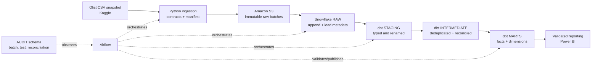
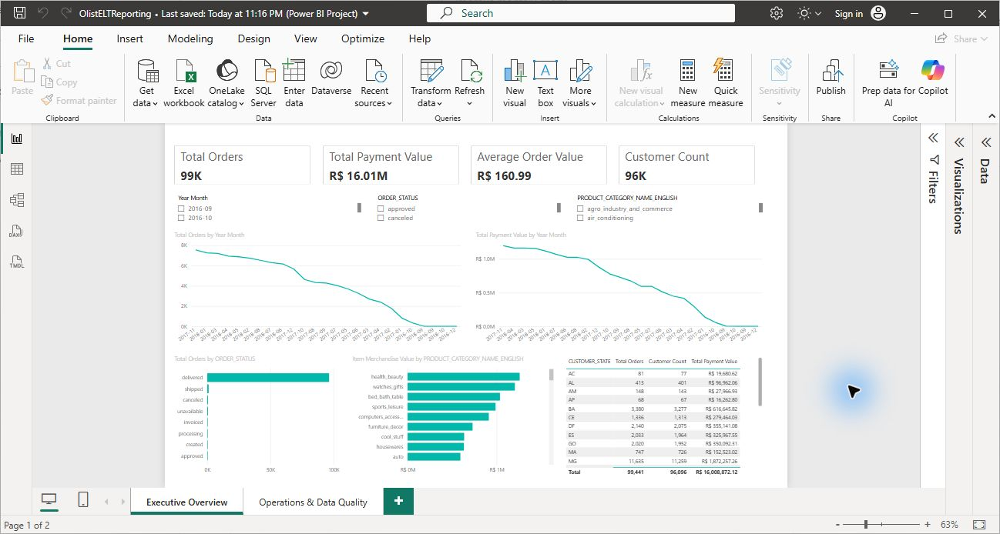
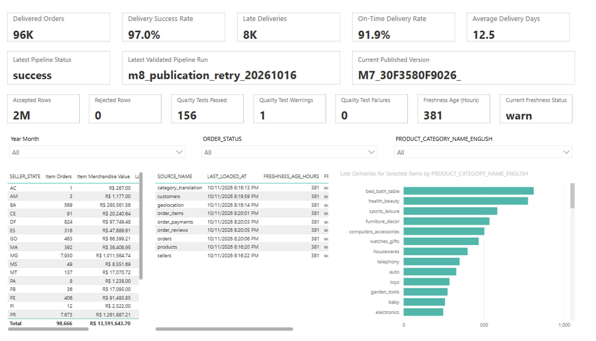

# Orchestrated ELT + Data Quality Pipeline

A portfolio-grade analytics engineering project that turns the Olist Brazilian e-commerce public dataset into a reproducible dimensional warehouse. The target platform is Python → Amazon S3 → Snowflake → dbt Core → Apache Airflow → Power BI, with data contracts, reconciliation, audit logging, and safe replay built into the design.

> **Status:** Milestones 1–10 are **Completed and validated**. The repository preserves real AWS, Snowflake, dbt, Airflow, monitoring/recovery, and Power BI Desktop evidence together with reproducible local checks. It is ready for final pull-request review as a GitHub portfolio project. Airflow is paused after validation; failure probes are disabled.

## Business problem

Marketplace reporting can overstate sales when order-item rows are joined directly to payment rows. It can also hide late deliveries, incomplete order lifecycles, and inconsistent reference data. This project designs a trusted reporting layer with explicit grains, independently aggregated monetary measures, and automated quality evidence.

## Verified at a glance

| Area | Validated result |
|---|---|
| Source and ingestion | 9 datasets; 26 deterministic batches; 129 CSV files; 155 S3 objects; 1,550,922 rows |
| Warehouse | 26 batches and 1,550,922 RAW rows reconciled with zero file/row differences |
| dbt | 24 models: 9 staging, 4 intermediate, 7 dimensions, 4 facts; 667,188 MARTS rows |
| Data quality | 156 tests passed, 1 documented source warning, 0 failures; 7/7 synthetic defects detected and recovered |
| Orchestration and recovery | 8-task Airflow DAG; publication blocked on failure; retry, rollback, and last-known-good preservation validated |
| Power BI | 15-table model; 41 DAX measures; 12 relationships; 2 pages; 33 native visuals |
| Reporting | 99,441 orders; R$16,008,872.12 tendered payment value; R$160.99 average order value |

## Architecture



See [architecture](docs/architecture.md) for schemas, replay behavior, and failure boundaries.

## Technology stack

| Layer | Technologies |
|---|---|
| Ingestion and storage | Python, Amazon S3, SHA-256 manifests, boto3 |
| Warehouse and transformation | Snowflake, SQL, dbt Core, `dbt-snowflake` |
| Orchestration | Apache Airflow 3.3.2, Docker Compose, PostgreSQL, LocalExecutor |
| Quality and observability | dbt tests, Python validation, Snowflake audit tables, Airflow task/run metadata |
| Reporting | Power BI PBIP/TMDL/PBIR, DAX, Snowflake Import mode |
| Engineering workflow | Git, pytest, Ruff, GitHub Actions, Markdown/Mermaid documentation |

## Dataset

[Brazilian E-Commerce Public Dataset by Olist](https://www.kaggle.com/datasets/olistbr/brazilian-ecommerce), version 2, was published by Olist under **CC BY-NC-SA 4.0**. The snapshot contains nine CSV files describing 99,441 orders from 2016-09-04 through 2018-10-17, including customers, items, payments, reviews, products, sellers, geolocation, and category translations. Raw files are intentionally excluded from Git.

Measured profiling highlights:

- 99,441 orders; 112,650 order items; 103,886 payment rows; 99,224 review rows.
- All six declared source foreign-key relationships have zero orphans.
- 261,831 exact duplicate geolocation rows and 42 coordinate rows outside a broad Brazil bounding box.
- 814 repeated `review_id` occurrences beyond the first; `review_id` is not a valid primary key.
- 303 shared orders differ by more than R$0.01 between item-plus-freight and payment totals.
- 7,827 delivered orders arrived after their estimated date.

Full evidence is in [dataset profiling](docs/dataset_profiling.md) and the machine-readable [profile](reports/data_profile.json).

## Engineering features

Milestones 1–10 are implemented and validated; Milestones 2–9 include real cloud or Power BI Desktop runtime evidence, while Milestone 10 reconciles and statically verifies the preserved results:

- Dependency-free dataset downloader, profiler, and contract validator.
- SHA-256 checksums, row/column/null/distinct/duplicate/date/range profiling.
- Primary-key and foreign-key validation for all appropriate sources.
- Deterministic historical replay and idempotency design.
- Explicit fact/dimension grains and order-level monetary reconciliation rules.
- Unit tests runnable on the repository's baseline Python 3.9 environment.
- Secret-safe configuration template and raw-data exclusions.
- Deterministic monthly transaction batches and a versioned reference snapshot.
- Canonical manifests with content-derived batch IDs, source/output checksums, byte counts, row counts, and logical timestamps.
- Idempotent local/S3 object uploads, manifest-last commit semantics, integrity checks, conflict detection, exponential retry, structured logs, and server-side encryption requests.
- Real S3 evidence for 26 batches and 155 objects: all remote keys, bytes, SHA-256 values, metadata, manifests, and AES-256 settings independently verified; the repeated full run uploaded zero objects.
- Version-controlled Snowflake schemas, CSV format, external stage, nine source-shaped RAW tables, audit tables, and validation views.
- Parameterized two-phase COPY loading with rejected-record capture, source/batch lineage, transactional reconciliation, duplicate prevention, and no-op reruns.
- Real Snowflake evidence for 26 batches, 129 files, and 1,550,922 RAW rows: exact batch/file reconciliation, zero key or relationship violations, and a 26-batch no-op rerun.
- dbt Core/Snowflake project with 9 staging views, 4 intermediate views, 7 dimensions, 4 incremental facts, 157 tests, secure targets, and a live generated catalog.
- Independent item/payment aggregation, deterministic surrogate keys, source-to-mart grain expectations, and reconciliation tests that prevent monetary fanout.
- Pipeline freshness from RAW load timestamps, batch/file/row audit reconciliation, exact RAW-to-staging preservation, and isolated seven-defect fail/detect/correct/pass evidence against real Snowflake.
- Real historical replay of all 26 batches through the same loader/dbt graph; zero differences across 9 RAW datasets and 24 models against the complete/full-refresh baseline. Isolated corrections, late arrivals, duplicates, and interrupted-load recovery passed without changing production fingerprints. See [incremental loading](docs/incremental_loading.md) and [measured evidence](reports/incremental_validation.json).

- Pinned Docker/Airflow workflow reuses eight pipeline boundaries, isolates candidate marts, and publishes eleven reporting views through one atomic version pointer. Real failure/retry/timeout and queued-overlap evidence confirms last-known-good reporting is preserved. See [orchestration](docs/orchestration.md) and [measured evidence](reports/orchestration_validation.json).

- Structured operational observations extend the existing audit events: typed failure categories, accepted/rejected/held accounting, preserved retry history, and reproducible run summaries. Five new real Airflow scenarios demonstrated quarantine correction, reconciliation/quality retries, and rollback of 74 uncommitted publication rows without changing production fingerprints. See [monitoring and recovery](docs/monitoring_recovery.md) and [lightweight monitoring summary](reports/monitoring_summary.json).

- Power BI reuses the eleven safe-publication views and three operational views. The validated PBIP contains 14 Import tables plus a dedicated measure table, 41 measures, 12 relationships, two pages, and 33 native visuals. Desktop refresh, DAX reconciliation, Date/category/seller interactions, disconnected operational behavior, and screenshots are documented in the [dashboard guide](docs/dashboard.md).

Planned—not yet implemented: external alert delivery. The measured validation-run success rate is not a production availability SLO.

## Warehouse design

The deployed `OLIST_ELT` warehouse separates `RAW`, `STAGING`, `INTERMEDIATE`, `MARTS`, and `AUDIT`. dbt built 9 typed staging views, 4 reusable intermediate views, and 11 dimensional marts containing 667,188 rows. Every model's grain and key is defined in the [data dictionary](docs/data_dictionary.md).

`item_total = SUM(price) + SUM(freight_value)` and `payment_total = SUM(payment_value)` are computed independently at order grain before joining. Payment value is not labeled accounting revenue; commission, refund, and seller-payout data are absent.

## Local reproduction

Prerequisites: Python 3.9+ for the dependency-free pipeline, Python 3.10+ for current dbt packages, `make`, internet access for the public Kaggle download, and about 170 MB of free disk space (126 MB extracted according to Kaggle metadata, plus the archive and profile).

```bash
cp .env.example .env
make download
make test
make profile
make validate
make ingest-local
make warehouse-validate
make dbt-expectations
make dbt-freshness
make quality-reconcile
make quality-synthetic
```

No credentials are required for the public download, local ingestion, or source-derived dbt expectations. Repeating the validated S3/Snowflake workflows or executing dbt requires approved resources and credentials. Detailed instructions and optional dependency groups are in the [setup guide](docs/setup_guide.md).

## Repository structure

```text
.github/workflows/       # lightweight local/static CI validation
dags/                  # Airflow DAG and opt-in timeout probe
docker/                # pinned image, dependency lock, local-secret initializer
compose.yaml           # local Airflow/PostgreSQL services
data/raw/              # ignored source CSVs
data/processed/        # ignored local derivatives
dbt/                   # Snowflake dbt project, models, tests, macros, profile template
docs/                  # architecture, runbooks, final audit, and screenshots
power_bi/              # PBIP/TMDL project, exact DAX, semantic and report specifications
reports/               # committed aggregate profiling evidence
scripts/               # operator entry points
sql/power_bi/          # operational reporting views and KPI validation queries
sql/snowflake/         # versioned warehouse and RAW loading infrastructure
src/olist_pipeline/    # Python contracts, ingestion, warehouse loading, validation
tests/                 # fast unit tests
```

## Dashboard preview

| Executive Overview | Operations & Data Quality |
|---|---|
|  |  |

The [semantic-model screenshot](docs/screenshots/semantic_model.png) shows the dimensional relationships and intentionally disconnected operational tables.

## Scope and limitations

- This is a validated single-host portfolio implementation, not a production deployment, HA architecture, or enterprise-scale benchmark.
- The Olist source is a fixed historical snapshot. Incremental arrival, corrections, failures, and recovery are deterministic replay/test scenarios, not real-time streaming or CDC.
- Airflow overlap protection covers the documented serialized deployment; no distributed lock or host-loss disaster-recovery guarantee is claimed.
- Tendered payment value is not accounting revenue: the dataset omits commissions, refunds, taxes, seller payouts, and recognition policy.
- Freshness measures pipeline load activity and will age for the fixed snapshot until the load/validation workflow is intentionally rerun.
- Cloud reproduction requires approved AWS/Snowflake resources and credentials; local checks and all setup contracts remain reproducible without storing secrets.

## Documentation

- [Project plan](docs/project_plan.md)
- [Architecture](docs/architecture.md)
- [Data dictionary](docs/data_dictionary.md)
- [Dataset profiling](docs/dataset_profiling.md)
- [Ingestion and S3 runbook](docs/ingestion.md)
- [Machine-readable S3 validation evidence](reports/s3_validation.json)
- [Snowflake warehouse and loading](docs/snowflake_warehouse.md)
- [Machine-readable Snowflake validation evidence](reports/snowflake_validation.json)
- [dbt transformations](docs/dbt_transformations.md)
- [Machine-readable dbt validation evidence](reports/dbt_validation.json)
- [Dimensional model](docs/dimensional_model.md)
- [Automated data quality and lineage](docs/data_quality.md)
- [Machine-readable data-quality evidence](reports/data_quality_validation.json)
- [Incremental loading and idempotency](docs/incremental_loading.md)
- [Machine-readable incremental evidence](reports/incremental_validation.json)
- [Airflow orchestration](docs/orchestration.md)
- [Machine-readable orchestration evidence](reports/orchestration_validation.json)
- [Monitoring and recovery](docs/monitoring_recovery.md)
- [Machine-readable monitoring evidence](reports/monitoring_validation.json)
- [Decisions](docs/decisions.md)
- [Setup guide](docs/setup_guide.md)
- [Validation report](docs/validation_report.md)
- [Troubleshooting](docs/troubleshooting.md)
- [Engineering journal](docs/engineering_journal.md)
- [Final validation and portfolio audit](docs/final_audit.md)
- [Power BI dashboard specification and build guide](docs/dashboard.md)
- [Machine-readable Power BI backend evidence](reports/power_bi_backend_validation.json)

## License

The project code and documentation are available under the [MIT License](LICENSE). The Olist dataset retains its separate CC BY-NC-SA 4.0 attribution and is not redistributed in this repository.
