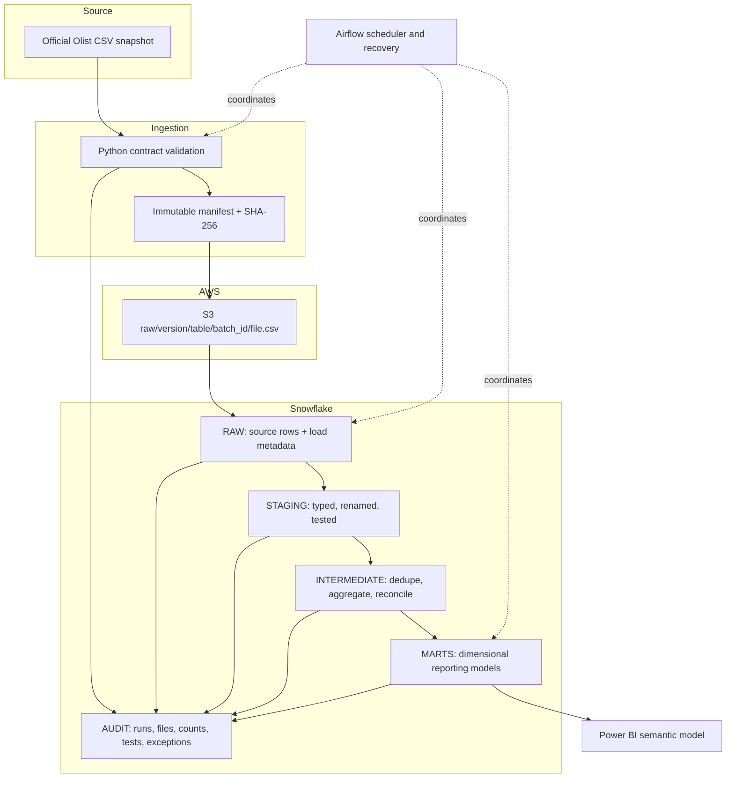
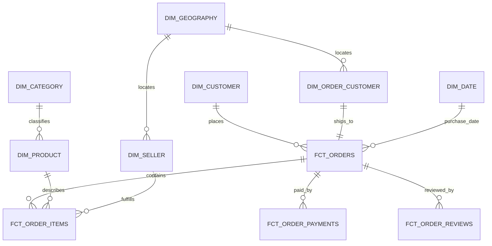

# Architecture

## Target flow



Milestone 2's S3 layer is populated and validated with 26 immutable batches and 155 objects. Milestone 3 loaded and reconciled all 1,550,922 source rows into Snowflake RAW. Milestone 4 built the complete 24-model dbt DAG in Snowflake: 9 staging views, 4 intermediate views, 7 dimensions, and 4 facts. Milestone 5 added load-timestamp freshness, audit/row reconciliation, 157 dbt tests, and isolated temporary-table failure injection without changing production data.

## Snowflake organization

Deployed database: `OLIST_ELT`.

| Schema | Responsibility | Mutation policy |
|---|---|---|
| `RAW` | Source-shaped tables plus `_batch_id`, `_source_file`, `_file_sha256`, `_loaded_at` | Append immutable batches; no business cleanup |
| `STAGING` | Cast types, normalize names, standardize empty strings, expose source keys and lineage | Nine dbt views derived one-to-one from RAW sources |
| `INTERMEDIATE` | Deduplicate geography and build independent item/payment order aggregates | Four rebuildable dbt views |
| `MARTS` | Seven dimensions and four conformed facts | Dimensions rebuild as tables; transaction facts merge incrementally |
| `AUDIT` | Batch manifests, task/run status, row counts, test outcomes, exceptions, publication state | Append events; controlled status transitions |

Quality controls read `AUDIT.BATCH_RECONCILIATION` and RAW `_loaded_at`. Freshness therefore measures real warehouse load activity rather than historical order events or deterministic replay dates. Synthetic failure probes use session-scoped temporary tables in `AUDIT`; they fingerprint but never mutate production RAW or MARTS relations.

The RAW layer stores source fields as `VARCHAR` so ingestion does not silently coerce source values. Each row also carries batch ID, staged filename, artifact checksum, source version, logical ingestion date, staged row number, load run ID, and load timestamp. Typing belongs in STAGING.

The `OLIST_ELT_ROLE` service role performs RAW loading through key-pair authentication and the pre-provisioned storage integration. It cannot create databases or schemas. Transformation, orchestration, and read-only BI privileges remain separate future concerns.

## Batch identity and deterministic replay

The public dataset is a fixed snapshot, not an event feed. Historical simulation therefore uses deterministic logical windows rather than pretending files arrived on dates they did not.

1. Hash each untouched source file with SHA-256 and record its byte size, row count, and source version in a manifest.
2. Define half-open monthly windows `[window_start, window_end)` over `orders.order_purchase_timestamp`. Only the 25 nonempty months are emitted.
3. Assign customers, order items, payments, and reviews to the window of their parent order. Load product, seller, category, and geography tables once in a separate reference snapshot under the same source version.
4. Derive `batch_id = sha256(source_version | manifest_hash | window_start | window_end | pipeline_contract_version)`.
5. Write immutable S3 keys containing source, logical ingestion date, batch ID, and table. Never overwrite a different checksum at an existing key.
6. Upload data objects first and the manifest last as the batch commit marker. A retry with the same checksum validates and skips objects; a checksum conflict fails closed. `AUDIT.FILE_LOADS` records enforce the same invariant in Snowflake.
7. `COPY` into a transient landing table, validate counts/types, then merge or append atomically into RAW. Publish marts only after all tasks and blocking tests pass.
8. dbt incremental facts use declared surrogate unique keys and overlap on `source_loaded_at`; a full refresh reproduces the same result from immutable RAW batches. Future Airflow runs will supply the orchestration interval without changing those content keys.

This permits chronological demos, reruns, isolated backfills, and failure injection without changing source truth. Late-arriving behavior will be tested synthetically and labeled as such because the snapshot has no ingestion-arrival timestamps.

## Failure and publication boundaries

- Download or checksum failure: no manifest is finalized.
- Partial S3 upload: the batch stays uncommitted and is safe to retry.
- Snowflake validation failure: landing data is discarded; previously loaded RAW data remains.
- CSV pre-validation failure: rejected-record details are written to `AUDIT.LOAD_ERRORS`; no RAW COPY begins.
- COPY or row-count mismatch: the current batch transaction rolls back and a failed batch audit record is committed separately.
- dbt compile/build/test or reconciliation failure: reporting views are not advanced to the candidate build.
- Power BI reads only the last validated publication identifier.
- Every retry reuses the logical Airflow data interval and batch ID.

## Dimensional model



`DIM_CUSTOMER` represents a person-level `customer_unique_id`; `DIM_ORDER_CUSTOMER` preserves each order-specific `customer_id` and its delivery location. This avoids falsely treating repeat purchases as different people while retaining historical order geography.

## Monetary safety

Items and payments are both one-to-many children of orders. Directly joining them creates a many-to-many fanout. The model will:

```sql
-- conceptual only
item_totals    = group order_items by order_id
payment_totals = group order_payments by order_id
orders         = orders left join item_totals left join payment_totals
```

`item_merchandise_value`, `freight_value`, `item_total_value`, and `payment_total_value` remain separate measures. Differences are surfaced, not forced to zero. “Revenue” is intentionally avoided because the dataset does not expose commission, refunds, taxes, seller payouts, or accounting recognition.

## Resource and cleanup estimate

The validated S3 prefix contains 124,509,854 bytes across 155 objects. Snowflake RAW contains 1,550,922 rows in nine tables and MARTS contains 667,188 rows in 11 relations, built by an X-Small warehouse with a 60-second auto-suspend. Cleanup must remove only explicitly approved project objects, including versioned S3 objects where applicable, and must occur only after evidence is retained and deletion is authorized.
