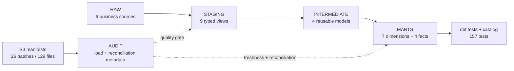

# Automated data quality and lineage

## Status and strategy

Milestone 5 is **Completed and validated** against real Snowflake as of 2026-10-14. It extends the Milestone 4 controls instead of duplicating them: 148 existing generic tests remain the key, relationship, value, and grain safety net; nine focused singular tests cover reconciliation and business chronology. The final run contained 157 dbt tests: 156 passed, one deliberately warned on a genuine 166-row source anomaly, and none failed or skipped.

Quality is enforced at four boundaries:

1. deterministic manifests and Snowflake `AUDIT` records reconcile batches, files, and rows;
2. RAW source tests protect source keys while `_loaded_at` measures pipeline freshness;
3. staging/intermediate tests validate typing, domains, chronology, and safe aggregation;
4. mart tests protect fact/dimension grains, foreign keys, and monetary reconciliation.

Blocking rules fail the workflow. A warning is reserved for a documented, understood source condition that must remain visible without rewriting source truth.

## Test catalog and coverage

| Control family | Count | Dimensions | Principal scope |
|---|---:|---|---|
| `not_null` | 82 | Completeness | Required source, staged, key, and measure fields |
| `unique` | 34 | Uniqueness | Natural and surrogate keys |
| `relationships` | 20 | Referential integrity | Sources, facts, and conformed dimensions |
| `accepted_values` | 4 | Validity | Order status, payment type, review score, translation state |
| `non_negative` | 4 | Validity | Prices, freight, payment values, installments |
| `unique_combination_of_columns` | 4 | Uniqueness | Item and payment component grains in staging and facts |
| Singular SQL tests | 9 | Consistency, reconciliation, analytical correctness | Lifecycle dates; review chronology; source anomaly; grains; item/payment totals; batch/file/row audit; RAW-to-staging counts |
| **Total** | **157** | All listed dimensions | **156 pass, 1 expected warning, 0 errors/skips** |

Equivalent generic tests were not recreated. Milestone 5 added only two production dbt controls: `assert_ingestion_batches_reconcile` and `assert_source_to_staging_row_counts`. The first reads the governed `AUDIT.BATCH_RECONCILIATION` view; the second compares all nine source relations with their one-to-one staging views.

## Business rules and severity

| Rule | Severity | Rationale |
|---|---|---|
| Required/unique business and surrogate keys | Error | A violated grain makes downstream measures ambiguous |
| Fact-to-dimension and source-child relationships | Error | Orphans break conformed analysis |
| Accepted domains and nonnegative source monetary fields | Error | Invalid values cannot support the declared metrics |
| Approval/delivery/review chronology with no observed exceptions | Error | These are supported by the validated source and indicate invalid transformations or a changed contract |
| Batch/file/row and RAW-to-staging reconciliation | Error | Missing or duplicated pipeline records are release blockers |
| Detail-to-order monetary reconciliation | Error with R$0.01 tolerance | One cent is the currency precision; larger transformation differences indicate loss or fanout |
| Carrier timestamp before purchase | Warning | The 166 records are present in the source and are preserved, not repaired or hidden |
| Freshness after 7 days | Warning | The fixed portfolio snapshot is validated weekly, so one missed weekly check is actionable |
| Freshness after 30 days | Error | Four missed weekly checks indicate an unusably stale pipeline load |

Payment-versus-item differences are not forced to zero: these are different source measures. The pipeline instead requires each measure to reconcile independently from RAW to its detail fact and then to the order fact.

## Freshness methodology

Freshness uses the maximum Snowflake RAW `_loaded_at` timestamp for each of the nine business sources. It never uses purchase, delivery, review, or deterministic logical replay dates because those describe historical business events, not pipeline arrival.

`dbt source freshness --target prod` checked all nine sources. At validation time the maximum observed age was 72 hours; all nine passed the 168-hour warning and 720-hour error thresholds. The audit source is excluded because the source freshness contract applies to loaded business relations. For a fixed historical snapshot, this measures the last successful warehouse load, not whether Olist has published newer business data.

## Reconciliation methodology and results

The reproducible `olist-quality reconcile` command queries aggregate metadata and relation totals only. On 2026-10-14 it measured:

- 26 successful batches, 129 distinct successful files, and 1,550,922 rows; expected-minus-loaded file and row differences were both zero;
- exact RAW-to-staging preservation for all nine datasets;
- exact RAW-to-fact counts for 99,441 orders, 112,650 items, 103,886 payments, and 99,224 reviews;
- merchandise R$13,591,643.70, freight R$2,251,909.54, and payments R$16,008,872.12, each identical at RAW, detail-fact, and order-fact grains;
- zero production rows carrying the reserved synthetic identifier prefix.

These controls complement the existing fact-to-dimension relationship and unique-grain tests. Item and payment children are still aggregated independently before meeting at order grain, preventing the known many-to-many fanout.

## Synthetic failure methodology and evidence

The deterministic fixture in `tests/fixtures/data_quality_synthetic.json` covers seven failure modes: duplicate key, null required key, orphan foreign key, invalid accepted value, negative payment, invalid date relationship, and reconciliation mismatch.

The integration runner creates session-scoped temporary tables in `AUDIT`; it never inserts into RAW, STAGING, INTERMEDIATE, or MARTS. It records row-count fingerprints for every production RAW and MARTS relation before and after the cycle and reserves the `__dq_synthetic_` prefix for leakage detection.

The real Snowflake cycle proved:

| Phase | Result |
|---|---|
| Clean baseline | All seven checks returned 0 defects |
| Inject | Each check returned exactly 1 intended defect |
| Correct | Defect rows deleted; the valid baseline row retained |
| Recovery | All seven checks returned 0 defects |
| Production integrity | Fingerprints unchanged; 0 synthetic rows before and after |

This distinguishes synthetic evidence from the 166 genuine carrier timestamp anomalies. A pipeline defect would appear as audit or row-count reconciliation failure; a transformation defect would appear in dbt grain, relationship, chronology, or monetary tests.

## Data lineage



`dbt docs generate --target prod` regenerated the live manifest and catalog from the real project state: 24 models, 10 declared sources, 11 marts, and 247 dependency edges. All nine business sources reach a mart; the tenth source is the audit reconciliation view and intentionally gates tests rather than analytics. Generated `dbt/target/` and logs remain ignored because they contain live warehouse metadata. Aggregate evidence is versioned in [`reports/data_quality_validation.json`](../reports/data_quality_validation.json).

The generated lineage graph was served locally and visually verified, including RAW sources, staging, intermediate aggregates, dimensions, facts, and quality-test nodes. The available browser capture could not safely persist the image into the repository, so no screenshot is claimed or committed. The remaining optional manual task is to run `dbt docs serve --project-dir dbt --target prod`, open the lineage graph, redact account/schema details if visible, and save an approved image under `docs/screenshots/`.

## Ownership and known limitations

- The pipeline owner owns ingestion integrity, warehouse reconciliation, dbt execution, test policy, and recovery evidence.
- The source owner owns the meaning and correction of genuine Olist data anomalies; this project preserves rather than silently repairs them.
- Analytics consumers own interpretation of GMV/payment measures and must not relabel them as accounting revenue.
- Freshness on a fixed public snapshot detects pipeline-load staleness, not a new upstream Olist release.
- Temporary synthetic checks validate control behavior but do not replace a disposable full-environment disaster-recovery exercise.

## Reproduction

With the ignored Snowflake configuration loaded and explicit integration opt-in set:

```bash
dbt source freshness --project-dir dbt --target prod
dbt test --project-dir dbt --target prod
PYTHONPATH=src python -m olist_pipeline.data_quality synthetic
PYTHONPATH=src python -m olist_pipeline.data_quality reconcile
dbt docs generate --project-dir dbt --target prod
```

The Python commands require `OLIST_RUN_SNOWFLAKE_INTEGRATION=1` and fail closed when it is absent.
