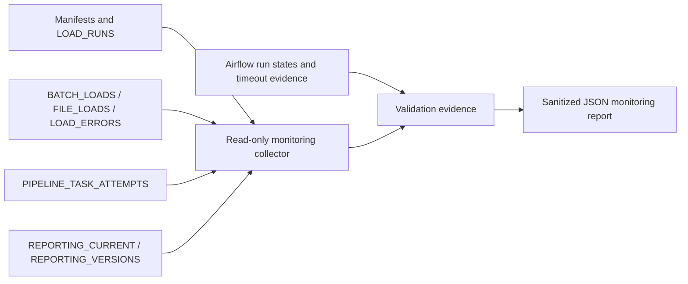

# Monitoring, rejection accounting, and recovery

Status: **Completed and validated** against real AWS/Snowflake and Airflow on 2026-10-16. No production incident is inferred from an intentional validation failure. DAGs are paused and failure probes disabled after validation.

Release finalization on 2026-10-19 rechecked local tests, documentation and secret exclusions. Compose services were stopped at that inspection; the cloud evidence below remains dated October 16 and is not a claim of current service health or freshness.

## Coverage audit and architecture

Milestones 2–7 already provide immutable manifests, structured ingestion events, transactional load/batch/file audits, COPY diagnostics, dbt artifacts, ingestion-time freshness, Airflow metadata, task-attempt events and publication history. Repeating those systems would create competing sources of truth.

The missing pieces were consistent failure categories, preserved quality metrics on failure, run-level operational summaries, distinct-row versus diagnostic accounting, and a measured rollback during publication itself. Milestone 8 extends `PIPELINE_TASK_ATTEMPTS.details` with a versioned `_monitoring` object and derives summaries from the existing records. No parallel run ledger, new cloud service, IAM permission, or external notification integration is introduced.



## Audit contract

The existing event key is DAG/run/task/attempt/state. Running and terminal events are intentionally separate; a failed attempt remains present after a successful retry. UTC timestamps and duration are recorded by the task boundary. Stage, failure category, sanitized reason code, scenario origin, optional row accounting, test failures/warnings, freshness, reconciliation, publication state, and warehouse load-run linkage live in `_monitoring`.

Task states are `running`, `success`, and `failed`. Airflow also exposes `queued`, `up_for_retry`, and `upstream_failed`; never pretend an upstream-failed task executed. Derived run state is the final audit task's terminal state, or `incomplete` when unavailable. Warehouse legacy `RUNNING`/`SUCCEEDED`/`FAILED` remains unchanged. Unknown metrics are null/`unknown`, not invented zeroes. `published` is derived from actual publication history, not merely from overall run success.

`warehouse_run_id` links successful RAW boundaries to `LOAD_RUNS`, then batch/file provenance. Reconciliation metrics describe verified inventory, not new work. Repeated runs verifying 1,550,922 rows must not be summed as newly ingested rows. `rows_loaded` is the actual insert metric. Synthetic accounting is separately labeled and never added to production row totals.

The collector reports unmatched running events and flags those older than 35 minutes (30-minute task timeout plus five minutes of observation slack). This is a diagnostic signal, not proof that a task is dead. Inspect Airflow and the owned process group before recovery. A host crash can prevent a terminal cloud audit event; Airflow remains authoritative for task scheduling and execution state.

Legacy M7 records are not rewritten. Their failure categories are marked as derived from the task boundary, with lower specificity than new explicit classifications. Final failed audit leaves are downstream summaries, not additional independent incidents. Success rate includes deliberate validation runs and is not a production availability SLO.

## Failure taxonomy

| Category | Meaning / response | Validation scope |
|---|---|---|
| ingestion | Source contract, preparation or manifest failure | Existing manifest/unit coverage; no new source corruption |
| s3_object | Object access, integrity or immutable-key conflict | Existing S3 controls; no new IAM/network outage injected |
| snowflake_load | Source validation, COPY or batch transaction failure | New isolated rejected-source scenario |
| reconciliation | Expected/actual count or metric mismatch | New deliberately wrong expected count; real RAW remains unchanged |
| transformation | dbt build/model execution failure | Typed dbt outcome capture; no new production model corruption |
| data_quality | Blocking business/test rule | New negative synthetic candidate evaluated by actual SQL |
| freshness | Ingestion-time source age check | Explicit dbt freshness classification; live freshness regression |
| publication | Reporting-copy/commit failure | New interruption after first reporting-store insert, before commit |
| timeout_interruption | Task/subprocess timeout or interruption | Actual M7 AirflowTaskTimeout logs reused and classified, not a new incident |
| infrastructure | Connection/OS failure or unavailable execution dependency | Sanitized fallback; no destructive infrastructure outage injected |

Only controlled scenarios are labeled synthetic. The 166 genuine carrier-before-purchase records remain source truth and a documented warning, not quarantine candidates or synthetic defects. Arbitrary exception messages are not copied into monitoring; typed failures accept only restricted uppercase reason codes. Full ignored dbt logs remain local operational artifacts, not committed evidence.

## Rejected records and quarantine

The production loader remains fail-closed: pre-load diagnostics block the whole batch before COPY; in-transaction failures roll back. `LOAD_ERRORS` retains source file/line diagnostics. One line can have multiple diagnostics, and missing line locations must remain unknown. The loader message now correctly says “error diagnostics,” not “rejected records.” Count distinct run/file/line identities for traceable rejected lines, not diagnostic rows. Do not infer accepted production counts from incomplete error locations.

The M8 fixture uses three fabricated rows in session TEMP tables inside AUDIT. One row is valid, a second has a null key and negative amount, and a third has a negative amount. SQL independently measures source, valid, and distinct rejected rows. Provenance is `synthetic://m8/records` plus source line and reason. No customer/source records are copied into evidence.

The whole-batch policy holds valid rows whenever any row is rejected. Thus “accepted” means passes row rules, not necessarily committed. `held_accepted_rows`, target rows, and inserted rows distinguish those concepts. Corrected input is validated, merged into the temporary target once, and merged again to prove zero duplicate inserts. The original failed-attempt audit is retained; the recovery record reports corrected status and zero open quarantine. Temporary tables are dropped in `finally` and disappear on session termination. There is no permanent quarantine dataset for these synthetic rows.

## Failure and recovery experiments

`scripts/validate_monitoring.py` runs five actual Airflow executions using the existing eight-task DAG:

1. `rejected_source`: two failed load attempts with measured row-level classification; downstream publication never starts.
2. `recovered_source`: corrected fixture merges once, rerun inserts zero, normal production no-op load and full build/gates/publication succeed.
3. `reconciliation_retry`: actual RAW validation passes, but an isolated expected-count contract is one higher; first attempt fails with measured difference, retry uses the correct count.
4. `quality_retry`: real candidate build/tests/freshness/reconciliation run; one synthetic negative monetary candidate fails a real SQL rule on attempt one, corrected input passes on retry.
5. `publication_retry`: first attempt inserts a real candidate copy inside the publication transaction, then deliberately interrupts. Rollback must remove all uncommitted version rows and leave the pointer unchanged. Retry publishes the validated version once.

No rejected fixture enters production RAW, dbt marts, or reporting stores. The publication-interruption scenario copies validated business data only. Candidate/reporting retention is unchanged from M7. Each scenario's final production/reporting fingerprints and monetary totals are compared with the initial snapshot. The fully failed run must also preserve publication pointer/history.

Retries preserve every failed attempt, its category, timestamps and metrics. Publication history must contain exactly one row for each successful run/version and no row for the failed source run. Store row counts for the current version must match their corresponding validated reporting views.

## Reproduction and monitoring

Use the existing ignored `.env` and approved AWS profile/key chain. With configuration loaded securely:

```bash
PYTHONPATH=src python -m olist_pipeline.monitoring --output data/processed/monitoring/current.json
```

The collector is read-only. It derives run totals, successful/failed/incomplete states, retry recoveries, observed task spans, retries, root failure categories, diagnostic/distinct-line accounting, latest verified inventory, quality/freshness results, actual inserts, publication history and current pointer. Average task span excludes scheduler queue latency and is explicitly not Airflow's total run duration. API run durations are reported separately in validation evidence.

For authorized scenario validation only, enable `OLIST_ENABLE_ORCHESTRATION_PROBES=1` when starting Compose, unpause the DAG, then run `PYTHONPATH=src python scripts/validate_monitoring.py`. It checkpoints fixed experiment IDs and reads existing completed runs on resume; do not reuse those IDs for different inputs. It does not reset completed runs or overwrite reporting history. Afterward pause the DAG and restart Compose with probes disabled. Do not run independent writers concurrently.

Diagnostic queries (read-only):

```sql
SELECT run_id, task_name, attempt, state,
       details:_monitoring:failure_category::VARCHAR AS failure_category,
       details:_monitoring:rejected_rows::NUMBER AS rejected_rows
FROM OLIST_ELT.AUDIT.PIPELINE_TASK_ATTEMPTS
WHERE state <> 'running'
ORDER BY started_at;

SELECT COUNT(*) AS diagnostics,
       COUNT(DISTINCT run_id, source_file, error_line) AS traceable_rejected_lines,
       COUNT_IF(error_line IS NULL) AS unlocated_diagnostics
FROM OLIST_ELT.AUDIT.LOAD_ERRORS;

SELECT * FROM OLIST_ELT.AUDIT.REPORTING_CURRENT;
SELECT version, run_id, published_at FROM OLIST_ELT.AUDIT.REPORTING_VERSIONS;
```

## Evidence and limitations

The [lightweight summary](../reports/monitoring_summary.json) and [detailed validation evidence](../reports/monitoring_validation.json) are generated from actual SQL/API/log results. `scripts/finalize_monitoring.py` checks all release invariants before writing completed status. Runtime logs, targets, checkpoint files, credentials and row-level source data remain ignored. No screenshot is claimed. Optional manual capture: authenticated Airflow grid for the rejected run and each retry, plus a redacted worksheet showing aggregate quarantine counts and current publication; save approved images under `docs/screenshots/`.

| New real Airflow run | Outcome | Seconds |
|---|---|---:|
| `m8_rejected_source_20261016` | Two rejected load attempts; downstream publication has zero attempts; DAG failed | 66.140 |
| `m8_recovered_source_20261016` | Corrected temporary fixture inserts three rows once, rerun inserts zero; all gates/publication succeed | 140.551 |
| `m8_reconciliation_retry_20261016` | Measured mismatch of one row fails; correct expected count passes on retry | 148.483 |
| `m8_quality_retry_20261016` | One synthetic negative candidate detected, then zero violations on corrected retry | 161.749 |
| `m8_publication_retry_20261016` | 74 uncommitted category rows rolled back to zero; pointer preserved; retry publishes once | 144.275 |

Rejected accounting per attempt is **3 source = 1 valid + 2 rejected**, with three diagnostics and zero inserted rows; the valid row is held. Two failed attempts produce four rejected-row evaluations, but only two distinct rejected source lines. Recovery is **3 = 3 + 0**, three inserts, zero repeat inserts, zero open quarantine. Temporary fixture relation count is zero. Historical `open` values in failed-event evidence are not current unresolved quarantine.

The combined M7/M8 task audit contains **9 runs: 7 successful, 2 deliberately failed**, four runs recovered within retries and one additional source-correction recovery across runs. There are six retry attempts, 73 terminal task events, no duplicate terminal keys, no unmatched running events, and seven unique successful publications. Airflow and derived cloud states agree for all nine runs. Success rate is 77.78% **including intentional validation failures**, not a production SLO. Average Airflow runtime is 147.736 seconds; latest runtime is 144.275 seconds. Task-audit spans, which exclude some scheduling overhead, average 143.786 seconds.

Actual failure categories (excluding downstream audit-summary failures) are four data-quality gate attempts, two source/load attempts, one reconciliation attempt and one publication attempt. Only one newly injected quality-rule violation occurred; earlier controlled gate failures do not imply failed production dbt tests. The separate verified M7 timeout probe contributes two actual AirflowTaskTimeout attempts and is explicitly outside the pipeline-run denominator.

The latest verified inventory remains 26 batches / 129 files / 1,550,922 RAW rows. New RAW inserts across these orchestration runs are zero. Production `LOAD_ERRORS` contains zero diagnostics; synthetic rejection evidence lives in task events, not production load-error rows. Current validated publication is `M7_30F3580F9026_`; all seven retained versions have exactly the expected counts in each of eleven stores. No publication occurred during any failed M8 attempt. Twenty production and eleven reporting fingerprints, order count 99,441, merchandise R$13,591,643.70, freight R$2,251,909.54 and payments R$16,008,872.12 are unchanged.

Final production regression: 156 dbt tests pass, one genuine 166-record source warning, zero failures; 13.927 seconds. Freshness passes 9/9 in 4.234 seconds; reconciliation differences and synthetic production rows are zero. Repository suite: 46 discovered, 41 pass, five expected skips in 12.890 seconds. Airflow suite: eight pass in 1.126 seconds. Offline suite: 39 pass, seven expected skips in 0.055 seconds. Pipeline skips are four Airflow-environment tests (passed separately) and the previously validated AWS upload/delete test; all five DAG runs exercised real S3 no-op validation.

The read-only collector reports quality/freshness as of the latest successful gate, not a new freshness measurement on every summary request. Run the actual gate to refresh those observations. Generated summaries retain exact counts and provenance rather than treating unknown metrics as successful zeroes.

No external paging/email channel is configured, no availability SLO is claimed from a small validation sample, and no distributed writer/host-loss disaster recovery is promised. Quarantine is an isolated demonstration; production malformed-file correction still requires an approved new immutable source/batch version. Never edit accepted source truth or reset ingestion timestamps to pass freshness.
