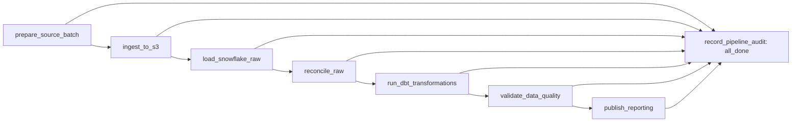

# Apache Airflow orchestration

Status: **Completed and validated** against real AWS/Snowflake on 2026-10-16. Final services are healthy, DAGs are paused, and failure probes are disabled. No Milestone 8 work is included.

## Local Docker architecture

Airflow 3.3.2 / Python 3.11 uses LocalExecutor, one scheduler, one DAG processor, one API/UI server, and PostgreSQL 16.13. A one-shot init service migrates metadata and creates the one-slot `olist_writer` pool. No Redis, Celery worker, triggerer, or extra paid cloud service is needed. This is a single-host portfolio environment, not an HA production deployment. See the [official Docker guidance](https://airflow.apache.org/docs/apache-airflow/3.3.2/howto/docker-compose/index.html) and [LocalExecutor architecture](https://airflow.apache.org/docs/apache-airflow/stable/core-concepts/executor/local.html).

The Airflow image is pinned by version and digest. A separate `/opt/pipeline-venv` contains locked dbt, boto3, and Snowflake dependencies so they cannot replace Airflow's dependency set. The Docker build context contains only the Dockerfile and requirements. Code mounts are read-only; data/runtime outputs use ignored `data/processed/`. PostgreSQL and task logs use project-scoped named volumes.

The UI binds only `127.0.0.1:8080`. Authentication remains enabled. `docker/init_local.py` generates random local passwords/JWT material without printing them. Runtime `.env`, AWS profile files, and the Snowflake key are never copied into an image. AWS/key mounts are read-only. The generated SimpleAuth password file is writable because Airflow opens it in append mode even when already populated. Docker access is equivalent to access to mounted secrets; this is not a multi-user security boundary.

## DAG and task contracts

`olist_elt_pipeline` executes:



| Boundary | Reused implementation / success contract |
|---|---|
| prepare_source_batch | `build_batches` only if missing; `validate_built_batches` checks the existing complete deterministic inventory/checksums; returns counts and batch IDs |
| ingest_to_s3 | `S3ObjectStore` + `upload_batches`; matching immutable objects skip; conflicting checksums fail |
| load_snowflake_raw | `WarehouseLoader` + `SnowflakeBackend`; same transactional batch/file audit and duplicate prevention |
| reconcile_raw | `validate_remote_warehouse`; schemas, manifests, actual RAW counts, keys and relationships must agree |
| run_dbt_transformations | Existing `dbt build`, all 24 models and 157 tests, against run-specific candidate aliases |
| validate_data_quality | Existing `dbt test`, ingestion-time `dbt source freshness`, and `collect_reconciliation`/`validate_reconciliation` against those candidate models |
| publish_reporting | Requires six successful gate records; copies eleven validated marts and commits one reporting pointer |
| record_pipeline_audit | Runs after all upstream tasks reach terminal states; summarizes execution and fails if any required task did not succeed, preventing an all-done leaf from masking DAG failure |

No datasets travel through XCom (`do_xcom_push=False`). Operational result files live under a deterministic run-ID hash in ignored storage. The only DAG-side implementation launches the stable package task CLI; it contains no source transforms or loading SQL.

## Scheduling and controls

- Weekly batch schedule: Monday 06:00 UTC, `catchup=False`. Unpausing may immediately create the most recent eligible scheduled run; it is not a streaming feed.
- `max_active_runs=1`, `max_active_tasks=1`, one-slot writer pool. Every state-mutating task uses that pool. The scheduler admits only one run of this pipeline at a time.
- One retry after 15 seconds; each task has a 30-minute execution timeout; subprocess boundary 25 minutes; each dbt command 15 minutes; entire DAG 2 hours. Audit has no retry to keep final failure visible.
- All publication ancestors use `all_success`; audit uses `all_done` and explicitly fails closed.
- These controls serialize this Airflow deployment. Do not concurrently run manual ingestion/dbt/publication writers or a second independent scheduler deployment against the same shared state. Snowflake ordinary unique constraints are not used as a distributed lock.
- An opt-in, no-cloud-write `olist_timeout_probe` DAG tests actual Airflow timeout/retry enforcement. Failure modes require `OLIST_ENABLE_ORCHESTRATION_PROBES=1`; ordinary operation leaves it unset/zero.

## Safe reporting publication

RAW and source audit tables remain shared and use the existing idempotent loader. dbt models use a deterministic `M7_<run hash>_` alias prefix in the existing STAGING/INTERMEDIATE/MARTS schemas. `OLIST_MODEL_PREFIX` affects models only; source identifiers remain the validated production RAW/AUDIT relations. An empty prefix retains existing production behavior; Milestone 6's combined source/model prefix remains supported.

Reporting consumers use `MARTS.REPORT_<model>` views, not mutable candidate tables or legacy unversioned build tables. Each of the eleven marts has a `REPORT_STORE_<model>` table with `_report_version`. Stable views join the single row in `AUDIT.REPORTING_CURRENT` to expose one validated version. The publication transaction inserts all eleven version copies, changes the one pointer, and appends `AUDIT.REPORTING_VERSIONS`. Any DML failure rolls back all of them. DDL initialization happens before this transaction and never replaces existing reporting views. A retry after a committed publication detects the same version and skips it.

Before the first successful publication, existing validated unversioned MARTS remain available; reporting views have no published version until that first transaction commits. Afterward, a failed build/test/freshness/reconciliation leaves the pointer and published rows untouched. Candidate and older published versions are retained for diagnosis/rollback. Rollback requires an explicit approved transaction selecting a version already present in publication history, after checking its eleven stores; it must not point to an unvalidated candidate.

Pointer changes are atomic for each Snowflake statement. Multi-query consumers needing a single cross-query snapshot must pin a specific retained version or coordinate refresh, rather than assume separate statements span an identical publication instant. Schema changes fail closed and require an explicit migration; this milestone does not automate incompatible reporting schemas or unlimited retention cleanup.

Re-executing publication for the current version is a no-op. Re-executing an older already-published run fails closed rather than copying its rows again or silently rolling reporting backward; use the explicit rollback procedure instead. Ordinary task timeout/cancellation terminates the boundary's owned process group, including dbt children. Host failure or uncatchable process termination still requires operator inspection; distributed disaster recovery is not claimed.

## Audit and evidence

Existing batch/file/load tables remain authoritative for source ingestion. `AUDIT.PIPELINE_TASK_ATTEMPTS` adds only orchestration metadata: DAG/run/version/task, attempt, running/success/failed state, UTC start/end, duration, and aggregate result/failure code. `REPORTING_VERSIONS` records successful publications. Connector exception details and environment values are not placed into shared audit records. Airflow metadata/logs retain scheduler task states, including tasks never started because of upstream failure. Hard termination can leave a running attempt entry; Airflow remains authoritative for its terminal state and a missing success record blocks publication.

## Startup, execution, and shutdown

From the repository, with the approved ignored `.env` present:

```bash
export AIRFLOW_UID=$(id -u)
python docker/init_local.py
docker compose config --quiet
docker compose build
docker compose up -d
docker compose ps
python scripts/airflow_control.py unpause
python scripts/airflow_control.py trigger --run-id my_manual_run
python scripts/airflow_control.py status --run-id my_manual_run
```

Do not run plain `docker compose config` in shared logs: resolved configuration can contain secrets. Retrieve the generated local admin password privately from `data/processed/airflow/passwords.json` when logging into the UI; the API helper reads it without printing it.

`docker compose logs --tail 100 scheduler` shows execution; `docker compose restart` restarts services without removing metadata. Pause the DAG with the helper before `docker compose stop`. `docker compose start` resumes existing containers; `docker compose down` removes containers/network but retains named volumes. Only after explicit confirmation, `docker compose down --volumes` removes this project's metadata and logs; never use a global Docker prune. Snowflake reporting/history/candidates are intentionally retained and require a separate scoped cleanup/retention decision. No S3 deletion is part of orchestration cleanup.

## Failure validation and recovery

With failure probes explicitly enabled, trigger `--mode quality_failure`. It performs real dbt tests/freshness/reconciliation, then deliberately fails before publication on both attempts. The final audit task fails the DAG and publication must be upstream-failed, not executed. Remove the injected mode by creating a normal run; `transient_failure` instead fails only the first quality attempt to prove automatic retry recovery. Neither mode modifies source rows.

Inspect Airflow failed-task logs and the ignored run result before retrying. Reuse source manifests; do not force COPY, repair historical dates, or disable quality rules. A previous published version remains available during recovery. A fixed source snapshot eventually becomes stale under the existing 7-day warning / 30-day error policy; do not reset ingestion timestamps solely to pass freshness.

## Measured end-to-end evidence

The [aggregate report](../reports/orchestration_validation.json) is reconstructed from actual Airflow API captures, task results, and Snowflake snapshots by `scripts/build_orchestration_report.py`. Detailed logs, profiles, and dbt targets remain ignored.

| Run ID | Result | Total seconds |
|---|---|---:|
| `scheduled__2026-10-12T06:00:00+00:00` | Eight successful tasks | 178.902 |
| `m7_success_20261016` | Queued behind scheduled run, then eight successful tasks | 130.439 |
| `m7_failure_20261016` | Quality failed twice; publication upstream-failed with zero attempts; final audit failed | 152.506 |
| `m7_recovery_20261016` | First quality attempt deliberately failed; retry passed; publication and audit succeeded | 206.577 |

Every run reused 26 batches and 155 S3 objects (129 CSVs + 26 manifests), with zero new uploads and zero additional RAW batches/files/rows. Real reconciliation measured 1,550,922 RAW rows, zero file/row differences, and unchanged source-to-fact and monetary results. Each build returned 24 successful models, 156 passing tests, one expected warning, and zero errors. Final standalone tests returned 156 pass / 1 warning in 10.108 seconds; freshness returned 9/9 pass in 3.534 seconds at a maximum ingestion age of 118 hours. The warning still represents 166 genuine source carrier-before-purchase timestamps.

| Task | Manual seconds | Recovery seconds (final attempt) |
|---|---:|---:|
| prepare_source_batch | 3.457 | 6.929 |
| ingest_to_s3 | 15.558 | 14.405 |
| load_snowflake_raw | 24.818 | 27.187 |
| reconcile_raw | 6.837 | 7.939 |
| run_dbt_transformations | 26.704 | 59.923 |
| validate_data_quality | 24.855 | 22.446 |
| publish_reporting | 19.745 | 18.753 |
| record_pipeline_audit | 4.388 | 3.956 |

Total run duration also includes scheduling gaps, failed attempts, and retry delay; task times are not additive throughput benchmarks. Recovery's first quality attempt lasted 24.679 seconds. The manual run began at 18:26:33.924433 UTC, after the scheduled run ended at 18:26:33.861016 UTC; its queued capture showed zero task attempts. The separate no-cloud timeout run `m7_timeout_verified_20261016` raised `AirflowTaskTimeout` on both attempts, with the final attempt lasting 2.075 seconds.

After the persistent failure, the pointer, publication history, eleven reporting fingerprints, twenty production RAW/MARTS fingerprints, and business metrics were identical to the preceding successful state. Recovery published a third validated version with identical business fingerprints. Reporting contains 667,188 rows across eleven views; orders = 99,441, merchandise = R$13,591,643.70, freight = R$2,251,909.54, payments = R$16,008,872.12. Differences are zero. No synthetic source records were injected; the reconciliation synthetic-row check returned zero. Snowflake retained 33 terminal task-attempt audit records across the four runs.

Final tests: locked pipeline environment discovered 38 tests, 33 passed and 5 skipped (four Airflow-only tests and the separately validated AWS integration), in 15.112 seconds. The actual Airflow environment passed all eight orchestration/DAG tests in 1.253 seconds. Offline host tests discovered 38, passed 31, skipped seven, in 0.059 seconds. Real S3 operations were exercised by the DAGs; the separate upload/delete integration test was not rerun in this milestone.

## Screenshots

Milestone 8 extends audit observations and adds separately labeled source rejection, reconciliation, quality and in-transaction publication recovery scenarios. It reuses this DAG, writer controls, version namespace and publication architecture. M7's measured results above remain historical evidence, not current cumulative run counts. See [monitoring and recovery](monitoring_recovery.md) for current operational summaries and synthetic-mode controls.

No screenshot is claimed until captured. If capture cannot be persisted safely, the exact optional manual task is to open the authenticated localhost UI, capture the pipeline graph plus successful/failed/recovery grids, redact local/account details, and save approved images in `docs/screenshots/`. Machine-readable API, task, publication and reconciliation evidence is the validation authority.
